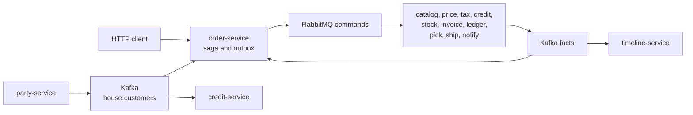
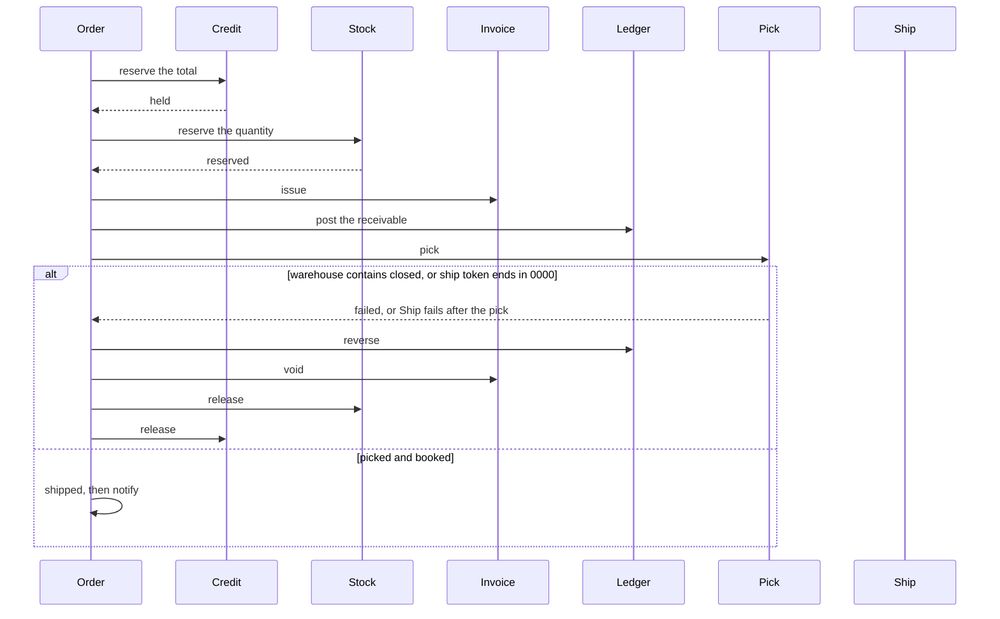

# House Account

A wholesaler sells on terms. Thirteen services each own one Postgres database. The order service is the saga orchestrator. It does not call the others over HTTP. A step commits its own row and an outbox message in one local transaction. A relay publishes that message. If a later step fails, the orchestrator writes compensating commands for the steps that already committed.

The house limit counts open reservations, including orders that have shipped. Cancelling an order releases that reservation. The receivable is a separate book: it is posted when the invoice is issued and reversed when a shipped-or-picked order is cancelled. This system has no payment step, so a shipped order keeps both the reservation and the receivable. Those two numbers are not added together.

Tax is `goods * 8 / 100` using integer division. A region whose text contains `blocked` is rejected, and that wins when the text also contains `exempt`. A region whose text contains `exempt` is taxed at zero. A warehouse whose code contains `closed` cannot be picked. A ship token that ends in `0000` is declined by the carrier. An email that ends in `@bounce.test` still leaves the order shipped, and the notice lands on a dead-letter queue.

A missing sku, a missing price, a blocked region, a declined limit, and a short shelf are normal business results. They cancel the order and do not use a dead-letter queue. A closed warehouse, a declined carrier, and a bounced address are rejected onto their dead-letter queues after the fact has been committed.





## The thirteen services

| Service | Owns | Takes part by |
| --- | --- | --- |
| party-service | customer, email, credit limit | publishing `house.customers` |
| catalog-service | sku and warehouse code | answering locate |
| price-service | unit price | quoting `unit * quantity` |
| order-service | the sales order and the saga log | writing the next command |
| credit-service | limit, exposed cents, one hold per order | `exposed + amount <= limit` |
| tax-service | the assessment | accepting or rejecting the region |
| stock-service | on-hand and one allocation per order | `on_hand >= quantity` |
| invoice-service | the invoice | issue, then void |
| ledger-service | the receivable and the postings | debit, then a reversal |
| fulfillment-service | the pick | pick, then cancel |
| shipment-service | the booking | book, or decline |
| notify-service | the delivered notice | deliver, or bounce |
| timeline-service | one row per fact | the read model |

Credit and stock use one conditional update. A second delivery of the same command is ignored because the inbox insert conflicts. The saga moves an order forward only from the status that step expects, so a repeated fact does not apply twice. Compensation follows that same status: a short shelf releases credit only, a failed pick also voids the invoice and reverses the receivable, and a failed shipment also cancels the pick.

The relay can publish a message and crash before it marks the row sent. The broker then holds a second copy. Consumers dedupe. There is no distributed transaction.

## Run

JDK 17, Maven 3.9, and Docker.

```bash
mvn -q -DskipTests package
docker compose up --build -d
./scripts/smoke.sh
```

| Process | URL |
| --- | --- |
| party-service | http://localhost:8161 |
| catalog-service | http://localhost:8162 |
| price-service | http://localhost:8163 |
| order-service | http://localhost:8164 |
| credit-service | http://localhost:8165 |
| tax-service | http://localhost:8166 |
| stock-service | http://localhost:8167 |
| invoice-service | http://localhost:8168 |
| ledger-service | http://localhost:8169 |
| fulfillment-service | http://localhost:8170 |
| shipment-service | http://localhost:8171 |
| notify-service | http://localhost:8172 |
| timeline-service | http://localhost:8173 |
| RabbitMQ management | http://localhost:15681 |
| Postgres | localhost:5441 |
| Kafka (host listener) | localhost:9102 |

```bash
docker compose down
```

## Calls

```bash
curl -s -X POST localhost:8161/customers \
  -H 'content-type: application/json' \
  -d '{"name":"Ada","email":"ada@shop.test","creditLimitCents":100000}'

curl -s -X POST localhost:8162/skus \
  -H 'content-type: application/json' \
  -d '{"sku":"MUG","warehouseCode":"CENTRAL"}'

curl -s -X POST localhost:8163/prices \
  -H 'content-type: application/json' \
  -d '{"sku":"MUG","unitPriceCents":2500}'

curl -s -X POST localhost:8167/items \
  -H 'content-type: application/json' \
  -d '{"sku":"MUG","onHand":10}'

curl -s -X POST localhost:8164/orders \
  -H 'content-type: application/json' \
  -d '{"requestId":"req-1","customerId":"CUSTOMER","sku":"MUG","quantity":2,"region":"SP","shipToken":"DOCK1"}'
```

The same `requestId` returns the original order and does not start a second saga. Two of that mug cost 5000 cents of goods and 400 cents of tax.

## Where the same split goes on AWS

This repository runs on Compose. Nothing in it calls a cloud account.

| Compose | AWS |
| --- | --- |
| Postgres 16 | RDS for PostgreSQL |
| Kafka 3.8 | MSK |
| RabbitMQ 3.13 | Amazon MQ, or SQS with a dead-letter queue |
| the thirteen services | ECS or EKS |

## Local credentials

The Compose network is open. Do not publish these ports.

| | |
| --- | --- |
| Postgres | `platform` / `platform` |
| RabbitMQ | `platform` / `platform`, vhost `/` |
| HTTP | no authentication |

## Tests

`mvn test` checks tax, the compensation matrix, the closed warehouse, the carrier token, and the bounce rule with no Docker. `./scripts/smoke.sh` ships an order, replays its request id, cancels the business failures, compensates a closed warehouse and a declined carrier, bounces a notice, and runs two overlapping cases: four orders against a limit of three, and eight orders against a shelf of five.

## Same shape, different domain

- [Live Lobby](https://github.com/joshbarros/java-live-lobby)
- [Loyalty Ledger](https://github.com/joshbarros/java-loyalty-ledger)
- [Claims Desk](https://github.com/joshbarros/java-claims-desk)
- [Checkout Counter](https://github.com/joshbarros/java-checkout-counter)
- [Study Hall](https://github.com/joshbarros/java-study-hall)
- [Clearing Desk](https://github.com/joshbarros/java-clearing-desk)
- [Thread Hall](https://github.com/joshbarros/java-thread-hall)
- [Yard Gate](https://github.com/joshbarros/java-yard-gate)
